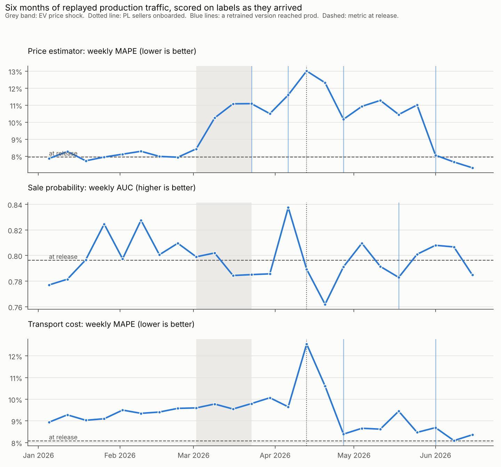
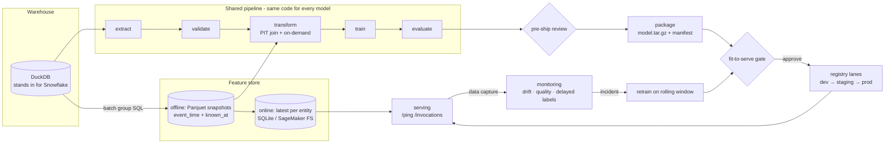

# Auction ML Platform

A shared ML platform that takes models from handoff to production and keeps them
there: one five-stage pipeline for every model, a point-in-time feature store with
online/offline parity, a pre-ship methodology review, a fit-to-serve gate,
SageMaker-contract serving with data capture, governed dev → staging → prod
promotion lanes, drift and delayed-label monitoring with calibrated thresholds,
and Terraform for the AWS side.

It is built around a synthetic European B2B used-car auction market with three
models on the shared platform, and a six-month replay of production traffic in
which the market shifts under them.

> All data is synthetic, generated by `python -m aucsim` (18 months, 63,732
> auctions, 50,773 vehicles, 44,172 transports, 495 sellers). Every number below
> was measured in this repository on a 2-vCPU machine. The AWS layer is validated
> (`tofu validate`, plan tests with a mocked provider, boto3 adapters tested with
> botocore's Stubber) but has not been applied to a live account. See
> [Scope](#scope-and-limitations).



## Results at a glance

| Area | Result |
|---|---|
| Models on one platform | `price_estimator` (MAPE **7.95%**, 69.7% within ±10%), `sale_probability` (AUC **0.796**), `transport_cost` (MAPE **8.08%**); a fourth model is added in a test from YAML + SQL only |
| Pre-ship review | the leaky price model scored MAPE **6.92%**, 13% *better* than the real one, and was **blocked for 4 reasons**; a backward-window bug that moved MAPE by **0.0001** was caught by the `known_at` audit alone |
| Fit-to-serve gate | packaged model predicts **bit-identically** in a fresh process; archive is **byte-reproducible**; **100%** of replayed requests assemble the same features through the serving path as in training; p95 latency 28–55 ms (budget 100 ms) |
| Skew detection | a serving transform computing age in years instead of months drops parity below **5%** and fails the gate (test) |
| Production replay | **57,842** requests served through the serving path, 26 weeks × 3 models monitored, **121 alerts → 68 pages** after incident grouping |
| Quiet weeks | 8 healthy weeks before the shock: **0 critical alerts**, 5 warning pages across 3 models |
| EV price shock (−20% over 3 weeks) | **no prediction-drift or critical input-drift alert**; slice-level performance flagged EV in week 1 and went critical in week 2; the retrain was approved that night with **+0.0127 MAPE** (95% CI +0.0106..+0.0145) vs the champion |
| New seller country (PL) | data-quality critical in all three models the first week; transport MAPE +55% → retrained; persistent-incident retrains brought all three back to release-level performance by June |
| Retrains | **7 attempted, 7 approved** in the final run, each gated against the prod champion on the same recent rows |
| Code quality | 38 tests, `mypy --strict` clean, `ruff` clean, Terraform `validate` + 3 plan tests |

Full outputs: [`docs/results/`](docs/results) (gate decisions, review reports, weekly monitoring tables, `production_replay.json`).

## Architecture



| Stage | Where | What it guarantees |
|---|---|---|
| Feature catalog | `feature_repo/catalog.yaml`, `transforms.py`, `sql/` | Every feature declares when it exists (`available_at`); every batch row carries `event_time` and `known_at`. On-demand transforms are one Python function used in training **and** serving. |
| Pipeline | `src/aucml/pipeline.py` | extract → validate (data contract) → transform (point-in-time join, time split that drops labels not yet arrived at the cutoff) → train (typed sklearn pipeline) → evaluate (metrics, baseline, bootstrap CI, slices). Same run ⇒ same run id ⇒ same weights. |
| Review | `src/aucml/review.py` | Blocks random splits on temporal data, labels known after the first test prediction, post-event features, non point-in-time joins, aggregates over values not yet known (backward windows), thin test sets; warns on suspicious single features and missingness shifts. |
| Packaging | `src/aucml/packaging.py` | SageMaker `model.tar.gz` (byte-reproducible) with a manifest: request schema, features, lineage, metrics, drift reference profile and calibrated thresholds. |
| Gate | `src/aucml/gate.py` | 8 checks (list below); writes a decision record next to the version in the registry. |
| Registry | `src/aucml/registry.py` | dev needs a non-blocking review; staging needs an approved gate; prod needs staging first and a named approver; rollback restores the previous version. |
| Serving | `src/aucml/serving/` | `model_fn/input_fn/predict_fn/output_fn` + `/ping` and `/invocations`; schema validation → 400; per-row capture log for monitoring. |
| Monitoring | `src/aucml/monitoring/` | PSI per feature and on predictions, unseen-category and null-rate checks, delayed-label performance overall and per slice, incidents (page once), sinks for JSONL, Slack, CloudWatch EMF. |
| AWS | `infra/terraform/`, `src/aucml/aws.py` | KMS, S3, ECR, IAM, Glue, one SageMaker feature group per catalog batch group, one endpoint per model with data capture, canary deployment with auto-rollback, autoscaling, CloudWatch alarms. |

### The fit-to-serve gate

A version is approved only if all of these pass:

1. pre-ship review does not block
2. primary metric meets the spec threshold
3. beats the spec baseline by the required relative margin (for AUC: lift above chance)
4. not worse than the current prod champion on the same rows (paired bootstrap, non-inferiority margin; the decision says when the test is underpowered)
5. no slice regresses beyond tolerance
6. the packaged artifact, loaded in a fresh process, reproduces in-memory predictions exactly
7. training/serving parity: test-window requests replayed through the serving path, with the online store loaded as of each day, produce the training features
8. p95 single-request latency within budget

Example: [`docs/results/gate_price_estimator_20260316.md`](docs/results/gate_price_estimator_20260316.md).

## Adding a model

A model is a folder in `models/` with a spec and the SQL that defines its population.
Nothing in `src/aucml` changes; `tests/test_platform_hygiene.py` fails if a model or
feature-group name ever appears in platform code, and `test_new_model_is_config_only`
adds a fourth model at test time.

```yaml
# models/sale_probability/model.yaml (abridged)
name: sale_probability
task: classification
prediction_point: listing          # features that exist only later are rejected
entities_sql: entities.sql         # entity_id, as_of, label, label_known_at, request fields
features: [listing.start_price, seller_90d.sell_through_90d, segment_market_28d.median_price_28d, ...]
split: {kind: time, train_start: 2025-03-01, cutoff: 2025-11-01, test_end: 2026-01-01}
baseline: seller_90d.sell_through_90d
slices: [listing.fuel, listing.seller_country]
gate: {primary_metric: auc, direction: higher, threshold: 0.75, champion_margin: 0.01, ...}
```

## Findings

These came out of building and running it, and are the parts I would discuss first.

1. **The model that looks best offline is the one that must not ship.** Adding the bid
   count (known only after the auction), joining features without point-in-time
   correctness and splitting randomly gave MAPE 6.92% against 7.95% for the honest
   model. The review blocks it on four independent checks.
   ([review](docs/results/review_price_estimator_leaky.md))
2. **Some leakage does not show up in metrics at all.** A lane-cost feature windowed on
   booking time instead of delivery time aggregates costs not yet known. It changed MAPE
   by 0.0001, so no metric-based sanity check would notice; it would still have been
   wrong in production. Every snapshot stores `known_at`, and the review fails any row
   where `known_at > as_of`. ([review](docs/results/review_transport_cost_by_booking.md))
3. **Input drift was blind to the most damaging event in the replay.** The EV price shock
   changed prices, not the inputs: no prediction-drift alert and no critical feature-drift
   alert fired. The only drift signal was a warning on the seller price-to-start ratio,
   which had fired just as often in the healthy weeks. Delayed-label performance *per
   slice* caught it (EV MAPE 8.4% → 17.9% in two weeks). Overall MAPE never crossed the
   critical line (it stayed at warning level, +29% to +46% against each serving version's
   release metric), so a policy on overall metrics alone would not have retrained at all.
   Slice-level performance monitoring is not optional.
4. **PSI thresholds have to be measured, not assumed.** Calibrating on a rolling backtest
   of the training period gave warn thresholds around 0.05–0.09 for vehicle attributes,
   but 1.4–3.5 for market-context features (rolling medians over ~19 segment keys), which
   move that much in healthy weeks. The folklore 0.1/0.25 would page constantly on those.
5. **The gate found two bugs in my own gate.**
   * It rejected `sale_probability` v1 for beating its baseline by "only" 6.9%. Relative AUC
     gains must be measured above chance (0.5): 0.745 → 0.796 is 21% more lift. The
     methodology was fixed; the 10% bar stayed.
   * It rejected all seven weekly retrain attempts with a 0.003 AUC non-inferiority margin. On a
     3-week window the 95% CI of the AUC difference is about ±0.008, so that margin could
     never be shown, and weekly production AUC already swings between 0.76 and 0.84. The
     margin is now 0.01, the gate reports when a comparison is underpowered, and retries
     back off for 4 weeks. The original rejection is kept in
     [`docs/findings/`](docs/findings/gate_sale_probability_margin_0.003_rejected.md).
6. **Alerts need state.** Without incident grouping, the PL onboarding re-paged every week
   for ten weeks. With it, 121 alerts became 68 pages, and a critical data-quality incident
   that stays open five weeks triggers a retrain once the new population is inside the
   training window.
7. **The offline-to-online gap is real even with perfect parity.** Transport cost tested at
   8.1% MAPE offline but ran at 8.9–10.1% from the first weeks of 2026: a fuel surcharge
   rising 1% a month moved the target while the features stayed in range. Parity proves
   the pipeline is right, not that the world stood still.
8. **Two retrains were not enough for the price model.** The first two shock retrains were
   better than their champions (CIs exclude zero) but EV prices kept falling and a 3-week
   test window lags. Performance returned to release level only after the late-May retrain
   that also contained PL sellers. A shorter retrain cadence during a shock, or a market
   index feature with a shorter window, would be the next things to test.

## Production replay

`scripts/production_replay.py` releases v1 of each model (cutoff 2025-11-01) through
review and gate to prod, then for every day from 5 Jan to 28 Jun 2026: loads the
online store as of midnight, sends that day's requests through the prod model's
serving path with capture on, and every Sunday scores the week for drift and data
quality and the previous week against labels that have arrived. Critical performance
alerts and long-running data-quality incidents trigger a rolling 8-month retrain,
gated against the champion. Runtime: about 8 minutes.

| Week of traffic | Event | What the platform did |
|---|---|---|
| 5 Jan – 1 Mar | normal market | 0 critical alerts; 5 warning pages (rolling-median features near their limits) |
| 2 – 8 Mar | EV prices start falling | EV slice warning |
| 9 – 15 Mar | | EV slice MAPE 17.9% (critical) → retrain → gate approves (+0.0127 MAPE) → prod |
| 13 Apr | PL sellers onboarded | unseen-category criticals in all three models |
| 13 – 19 Apr | | transport MAPE 12.6% (+55%) → retrain approved |
| May | PL incident open 5 weeks | persistent-incident retrains for all three models, all approved |
| June | | price MAPE 7.3–8.1%, AUC 0.78–0.81, transport 8.1–8.7%, no critical alerts |

Per-model weekly tables: [`docs/results/monitoring_*.md`](docs/results).

## Running it

```bash
pip install -e ".[dev]"
python -m aucsim                       # synthetic warehouse -> data/warehouse.duckdb
aucml materialize                      # batch feature groups -> store/offline
aucml release price_estimator --lane staging   # run, review, package, gate, promote
aucml review price_estimator_leaky     # exits 2: blocked
aucml promote price_estimator <version> prod --approved-by you
aucml serve price_estimator            # SageMaker HTTP contract on :8080

python scripts/production_replay.py    # six months of production, ~8 min
python scripts/review_report.py        # review reports for every spec
pytest -q                              # 38 tests, ~2.5 min
cd infra/terraform && tofu init -backend=false && tofu validate && tofu test
```

CI (`.github/workflows/ci.yml`) runs lint, strict typing and tests, releases every model
to staging through review and gate, asserts the deliberately broken specs are blocked,
and validates and plan-tests the Terraform. Promotion (`promote.yml`) is a manual
workflow per lane: the registry enforces the rules, the `prod` GitHub environment adds a
required reviewer, and `tofu apply` rolls out with a 10% canary that rolls back on the
5xx or latency alarm.

## Scope and limitations

* **Synthetic data.** The market generator plants the effects being tested (relistings,
  late labels, a price shock, a new country, a post-event field). Results show the
  method, not real-world accuracy.
* **Local stand-ins.** DuckDB stands in for Snowflake (the SQL is plain ANSI with
  `ASOF` joins), SQLite for the SageMaker online store, a filesystem registry for the
  SageMaker Model Registry. The AWS adapters share the same interfaces and are tested
  against botocore's Stubber; the Terraform validates and plan-tests with a mocked
  provider. None of it has been applied to a live AWS account.
* **Weekly batch monitoring.** Drift and performance are scored weekly; drift could be
  scored daily from the same capture log.
* **One estimator family.** Every model uses histogram gradient boosting; the platform
  does not depend on that, but nothing else has been run through it.
* **Latency** is measured in-process on 2 vCPUs, not behind a SageMaker endpoint. About
  10 ms of each request is Python-level tree traversal (500 trees).

## Repository layout

```
src/aucml/            platform core (model-agnostic)
  config.py           typed specs and catalog (pydantic)
  featurestore.py     offline PIT joins, online store, single assembly path
  pipeline.py         extract, validate, transform, train, evaluate
  review.py           pre-ship methodology review
  packaging.py        model.tar.gz + manifest
  gate.py             fit-to-serve decision
  registry.py         promotion lanes, rollback
  serving/            SageMaker handlers + HTTP app
  monitoring/         drift, alerts, incidents
  aws.py              SageMaker Feature Store + Model Registry adapters
src/aucsim/           synthetic auction market
feature_repo/         feature catalog, SQL, on-demand transforms
models/               one folder per model; _experiments/ holds the broken ones
infra/terraform/      modules: ml_platform, feature_group, model_endpoint; plan tests
scripts/              production replay, review report, tfvars rendering, chart
docs/                 results, runbook, findings
```
